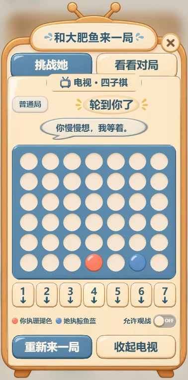

# 掌上游戏机与小游戏

点击床头柜旁的掌上游戏机或工具栏的“游戏机”。默认普通局，可以选认真局。多人分别挑战，各自持有一盘进行中的对局，不需要排队；同一人要先结束旧局再开新局。

## 规则

- 四子棋：七列六行，点击列号或棋盘对应列落子。棋子从底部堆叠，横、竖、斜连成四颗获胜。普通局检查直接胜负、短程攻防，允许选择略弱的候选；认真局搜索更深，不承诺她必胜。
- 你落子后，她会停顿再下：普通局约 2～4.5 秒，认真局约 3.5～6 秒。等待时不能重复落子。思考回合保存在服务端，关闭页面、刷新或重启不会让她额外落子或提前亮出结果。
- “收起游戏机”只是关闭界面，下次可继续；进行中的“重新来一局”会先确认，可选择重开或只收起当前局，结束旧局会记为认输。三十分钟无落子或设置操作的未结束对局会收起，不计胜负。新开局可选择是否公开结束后的记录，连续再开一局会沿用当前选择。

## 普通局与模型

落子、判胜和库存一样由本地程序负责，不需要每步向 DeepSeek 或其他大模型发请求。没有 AI 服务也能完整游玩。

连接 QQ/DSH 后，结束的对局可点“听她复盘”。任务使用当前部署的聊天模型，在聊天不忙时处理；每分钟最多启动一份，不向 QQ 自动广播对局。未配置服务时不显示模型复盘按钮。复盘会保留真实棋谱与结果，模型不可用也不丢失战绩。

失败后可重试复盘，每盘最多三次；处理被中断时会结束等待，不自动重复调用。模型型号优先读取部署者明确配置，再读取代理自己的默认型号，避免空配置退回已不支持的旧型号。独立 API 部署请按自己的服务填写型号，不复制他人的密钥。

旧桥接升级时更新 `game-core-adapter.mjs`，并给 `gameCore.tick` 传入 `isArcadeBusy` 回调，只判断实际会话是否忙碌；不要让主动消息的十五分钟静默限制挡住玩家主动请求的复盘。新版 `stage-bridge.mjs` 已包含此回调；`game-bridge-hooks.mjs` 也接受同名选项。若复用旧版本，未传入时会保守使用原 `isBusy`，可能等更久。

## 对战记录与身份

“对战记录”分为“我的记录”和“大家的记录”，每页二十局。自己的结束、收起对局和复盘可以重新打开；大家的记录包含本人记录及其他人已公开的结束对局，不再提供实时观战。点开棋谱可回到开局、上一步、下一步或看终局，复盘原文保存在同一局中，开新局和重启都不会覆盖。

新开局的“公开这局记录”默认勾选，可关闭；旧版本未公开的记录不会自动公开。只显示展示昵称，不公开 QQ、私聊或其他私人记忆。公开记录包含棋谱和该局复盘，其他人只能阅读，不能操作或请求模型复盘。关闭公开会撤销访问，已打开的页面在下次同步时退出。

猜拳已停止开放，旧存档保留；未结束的旧猜拳会收起，不阻挡四子棋开局，不计入四子棋战绩或记录列表。

已验证 QQ 使用同一个私有身份键，跨浏览器、不同昵称仍关联自己的战绩。未验证者只关联当前浏览器访客会话，不能靠填写 QQ 冒认他人。只有已验证本人的结束对局会进入该 QQ 的个人经历，供小屋聊天和 QQ 私聊使用；访客不读取这些记录。

## 存档与升级

对局、棋谱、战绩及复盘均保存在现有 SQLite 数据库，`npm run backup` 会一起备份。升级自动新增 `arcade_*` 表，不重建原生活存档；请求编号与棋局版本防止重复落子。公开发布仍排除整个 `state/`。

公开网关和 Cloudflare 转发白名单增加 `/api/room-arcade`、`/api/room-arcade-view`、`/api/room-arcade-action` 三条。升级时同时更新本机网关适配器、游戏核心和网页，保留原桥接与配置备份；不开放任何 `/internal/*` 接口。

QQ 桥接读取部署者本机 `room.config.json` 中的 `publicRoomUrl`，把正式入口与放食物、公开相册、游戏等用途放进当前生活上下文。私聊和群聊都使用这份入口；未配置时不编造链接。地址只留在部署者本机，公开代码不硬编码个人实例。分享继续使用已有白名单和频率控制，主人日记与个人记忆权限保持不变。

掌上游戏机使用内置 Image Gen 生成的独立透明素材，屏幕提示、棋盘、按钮、规则和状态由代码绘制。未改变原大肥鱼角色素材及其许可。

## 演示画面

以下为隔离演示存档，使用访客昵称，不包含真实账号、聊天或私人记录。

